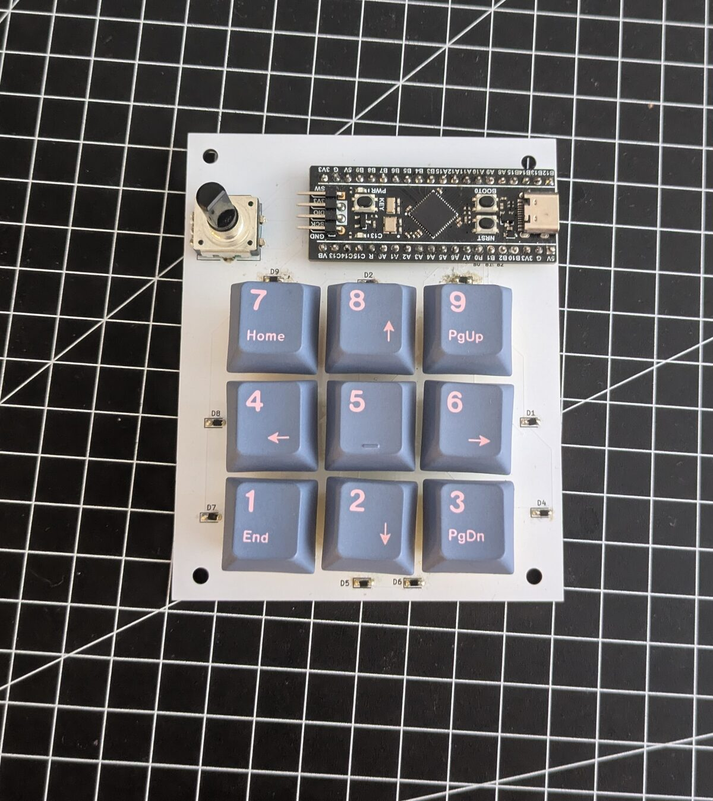

# Macro Keypad 

**Programmable Macro Keypad**
Allows for macros with length up to 16 chars for 9 keys on 3 layers.

It's functional and the core features work, but there's still some work to be done.

The project is written without an RTOS, just plain bare metal with STM HAL.

I also designed the PCB and ordered it online.

*This is my first embedded project and it is purely educational.*
*Feel free to criticize it, I'm still learning.*

## Hardware

- STM32 Black Pill 
- Some spare switches & keycaps I had lying around
- EC12 Encoder
- Custom daughter board
- 1N4148 diodes in a SOD-323 package

## Repo Structure

Repo consists of:
* firmware - main macro keypad logic and functionality
* bootloader - bootloader that allows for programming macros and flashing firmware through CDC
* programmer - host-only tool for programming macros and flashing firmware
* c_libs - TinyUSB src

## Finished product

*Yes, I'm aware the buttons are crooked, I misaligned them while soldering, mb.*

##### Disclaimer
No AI code generation was used for this project to enhance the learning process.
*It was, however, used for things like research and reading the datasheets to speed things up.*
